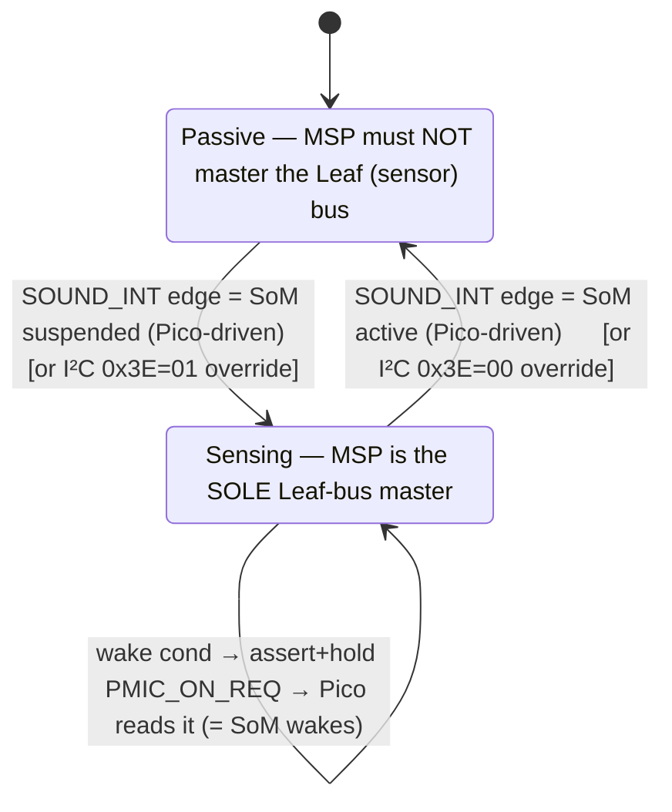

# MCU bench — description

**What it is:** a **firmware-development bench made of MCU boards only**, each **connected to the dev
machine (Mac/Linux) by USB**. No carrier, no i.MX8 SoM, no level shifters. The **RP2040 (Pico) is the
Stem-bus master — the stand-in for the SoM/M7** — and the MSP430s are the Stem-bus slave nodes. It's
where the `stem` firmware is developed and run (incl. automated ad-hoc/soak), SoM-free.

**Current members** (Henrik 2026-10-01): **FR2355, FR2476, FR2433, RP2040** (Pico H). All **3.3 V**, so
buses are direct-wired. *(Roster is fluid — Henrik has many boards; a 2nd FR2476 would share the same
pins. `hwd.toml` aliases the MSP430s on the bench — keep it in sync.)*

## This is NOT big-bob-bench and NOT bench-v1
- **big-bob-bench** / **bench-v1** (`bob-929/Hardware/bench/`) = the **SB-UCM carrier + 1.8 V SoM +
  shifters + many modules**. A different, larger bench. Don't drag carrier pins / I2C4 / 1.8↔3.3 V
  shifters into this one.
- This MCU bench = **boards + USB + jumpers**, 3.3 V throughout.

## It DOES relate to them — via one rule: same firmware ⇒ same per-board pins
**We run the SAME firmware on every bench.** So each board's **Stem/Leaf pins are fixed per board** (by
that board's firmware/model) and are **identical on this bench, big-bob-bench, and any bench.** Benches
differ in *topology and voltage* (master = Pico here vs SoM there; 3.3 V here vs 1.8 V + shifters
there), **never** in a board's own pin assignment. So wire each board to the shared bus using **its
canonical pins below** — don't invent per-bench pins.

## Per-board canonical pins (confirmed Henrik 2026-10-01; source in each board's model/firmware)
| Board | Firmware | **Stem SDA** | **Stem SCL** | **Leaf** (sensor master) | Source |
|---|---|---|---|---|---|
| **RP2040 Pico H** (master) | `debug/stem-probe` | **GP18 = pin 24** | **GP19 = pin 25** | I2C0 GP4/GP5 | `ziloo/Hardware/pinmux/model.rp2040.yaml` |
| **FR2355** (dual-I²C, canonical stem part) | prod `fr235x` | **P4.6** | **P4.7** | UCB0 P1.2/P1.3 | FR2355 ds SLASEC4D p24 (signal) + p102 (P4SEL=01) |
| **FR2476** (dual-I²C) | prod `fr247x` | **P3.2** | **P3.6** | UCB0 P1.2/P1.3 | `crates/bsp/connections.toml`; FR2476 ds p67 (P3SEL=01) |
| **FR2433** (single-I²C) | prod `fr24xx` | **P1.2** | **P1.3** | — (its only bus is Stem) | `stem/prod` |

**Stem bus wiring (this bench):** one shared bus — tie all **SDA** together (RP pin 24 ↔ FR2355 **P4.6**
↔ FR2476 **P3.2** ↔ FR2433 **P1.2**), all **SCL** together (RP pin 25 ↔ FR2355 **P4.7** ↔ FR2476 **P3.6**
↔ FR2433 **P1.3**), common **GND**. RP2040 is master; each MSP430 is a slave at a distinct address. RP
internal pull-ups on; 3.3 V, no shifter. (Leaf = each node's own sensor subtree, separate.)
> ⚠️ The dual parts' Stem pins are **NOT the same** across chips — the UCB1↔pin mux differs: **FR2355
> = P4.6/P4.7**, **FR2476 = P3.2/P3.6** (verified per-datasheet). FR2433's Stem is its only bus (UCB0
> P1.2/P1.3) — the *same physical pins* that are the **Leaf** bus on the dual parts, opposite role.

## Host control (all over USB, from the dev machine)
- **RP2040:** `picotool` (flash, `reboot -f`→BOOTSEL) + USB-CDC console/commands (`id`/`scan`/`read`/
  `boot`). Ids in `hwd.toml`. Future: `thepia hwd pico` (proposal in `docs/proposals/`).
- **MSP430s:** `thepia hwd` over eZ-FET (flash/console/reset); aliases in `hwd.toml`.
- Python tooling via **`uv`**.

## Purpose
Prove the stem contract **across silicon with no SoM** — the RP2040 master reads an MSP430 node's slave
regmap and conformance-checks it — and run it automated in CI, UCM-free. The RP2040 duplicates the M7's
mastering so results transfer to the real M7.

## Power modes the MSP must respect — and the bench demo
The MSP (Sensing Supervisor) has two postures. **The real trigger is hardware: the MSP edge-triggers on
the Stem-bus power-status signals the SoM/PMIC drive, to decide when to start and stop mastering the
Leaf bus.** On this bench the **Pico simulates those signals** — it stands in for the SoM *and* the
PMIC. The I²C `0x3E` MODE_CTRL (`0x00`=Passive, `0x01`=Sensing) stays as a **manual override**. *(This
is NOT the MSP↔PD-controller handshake — the CYPM1111 PD controller is independent and NOT on this
bench; see memory `mcus-independent-no-handshake`.)*

**Invariant (safety-critical): exactly one master on the Leaf bus at any instant.** Passive ⇒ MSP
tri-states UCB0 (off the bus); Sensing ⇒ MSP masters UCB0 and enumerates.

### Stem-bus signals the FR2355 must access (6 lines + GND)
| Signal | Dir (MSP) | FR2355 pin (BoosterPack hdr) | ↔ | Pico (SoM+PMIC stand-in) |
|---|---|---|---|---|
| Stem **SDA** | bidir | **P4.6** → **J2.15** | ↔ | GP18 (pin 24), I²C1 master |
| Stem **SCL** | bidir | **P4.7** → **J2.14** | ↔ | GP19 (pin 25), I²C1 master |
| **SOUND_INT** | **in (edge)** | **P2.0** → **J2.19** | ← | **GP10 (pin 14)** drives (suspend/resume cue) |
| **POR_B** | **in (edge)** | **P2.1** → **J4.40** | ← | **GP11 (pin 15)** drives (power-on-reset) |
| **PMIC_ON_REQ** | out | **P2.2** → **J2.18** | → | **GP12 (pin 16)** reads (= PMIC wakes SoM) |
| **STEM_INT** | out | **P2.4** → **J4.33** | → | **GP13 (pin 17)** reads (MSP→SoM notify) |
| Leaf SDA / SCL | — | **P1.2 → J1.10 / P1.3 → J1.9** | ↔ | GP4 / GP5 (I²C0) — see below |

Allocated + header-verified via the pinmux model — **`ziloo/Hardware/pinmux/model.fr2355.yaml`** (48-PT,
datasheet + SLAU680 Figure 10 cited). All four sideband pins are **interrupt-capable** (PORT2 vector)
and on BoosterPack headers. **Note: `P2.3` is NOT routed to any header on the LaunchPad** (onboard-only)
— that's why `STEM_INT` sits on **P2.4**, not P2.3. Still verify none of P2.0/P2.1/P2.2/P2.4 clash with
the onboard S1/S2 buttons (SLAU680 schematic). `PMIC_ON_REQ` on the *product* is open-drain to 1.8 V
(bench 3.3 V direct — fine). **Firmware gap:** edge-trigger-on-`SOUND_INT`/`POR_B` mode logic is **not
implemented** (only the I²C MODE_CTRL path exists — DESIGN.md open-Q#4); it's new MSP firmware.

### Leaf-bus wiring on the Pico
On the **other I²C controller** from the Stem master (distinct-controller rule):
- Pico I²C0 **GP4 (SDA, pin 6)** ↔ FR2355 **P1.2** ↔ I/O-extender SDA
- Pico I²C0 **GP5 (SCL, pin 7)** ↔ FR2355 **P1.3** ↔ I/O-extender SCL
- common **GND** (Pico pin 8). (Stem master on I²C1 GP18/GP19; Leaf on I²C0 GP4/GP5.)

### Test scenarios
| # | Pico action | FR2355 reaction | Pass check |
|---|---|---|---|
| **S0** | read mode (status byte) | — | boot default = Sensing (when built) |
| **S1** | drive **SOUND_INT** = active (SoM awake) | edge → `release_sensor_bus()`, tri-state UCB0 | MSP off Leaf; mode = Passive |
| **S2** | drive **SOUND_INT** = suspended | edge → `acquire_sensor_bus()`, master Leaf + enumerate | extender in scan; mode = Sensing |
| **S3** | while Sensing, trigger a wake condition | MSP asserts **PMIC_ON_REQ** (held) | Pico reads PMIC_ON_REQ high |
| **S4** | toggle SOUND_INT repeatedly | clean acquire/release each cycle | no bus wedge; enumerate stable |
| **S5** | (override) write `0x3E` = 00/01 | same as S1/S2, via I²C | manual mode control works |

**Ordering rule (the Pico's own, NOT a handshake):** if the Pico also masters the Leaf bus (to play
"SoM owns the sensor bus while Passive"), it drives Leaf **only** while the MSP is Passive and gets
**off** before commanding Sensing. Two masters = corrupted bus.

**Prereqs:** (1) allocate the 4 FR2355 sideband pins (pinmux) + matching Pico GPIO; (2) MSP firmware:
edge-trigger-on-`SOUND_INT`/`POR_B` mode logic; (3) Pico `stem-probe`: GPIO drive/read for the 4
signals + a `write <reg> <val>` / `mode` command for the I²C override.

## See also
`RP2040-BENCH-HOST.md` (host firmware/design) · `ziloo/Hardware/pinmux/` (pin models) ·
`bob-929/Hardware/bench/` (the separate big-bob-bench).
